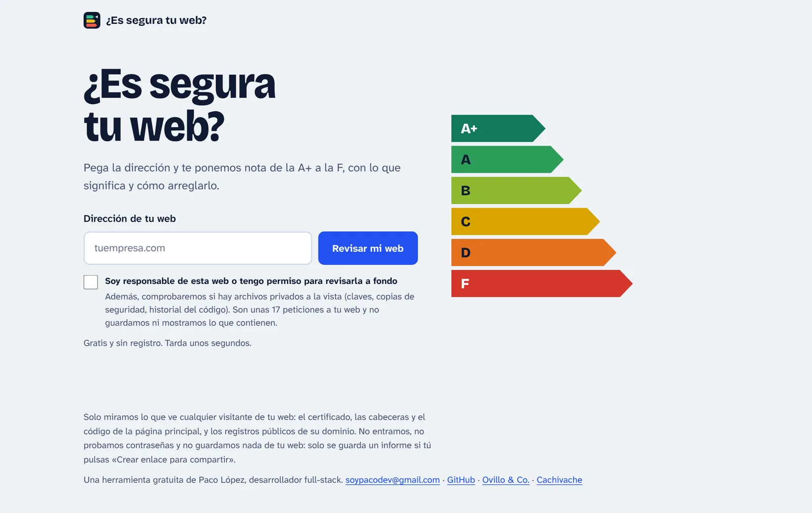
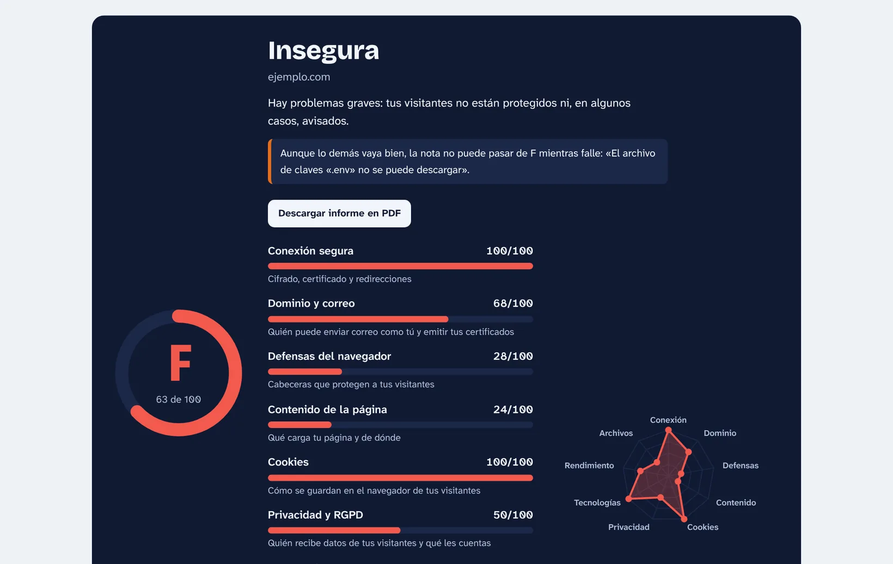
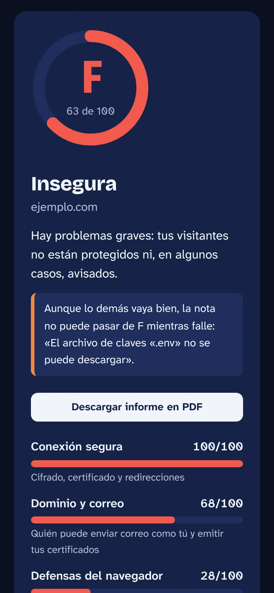
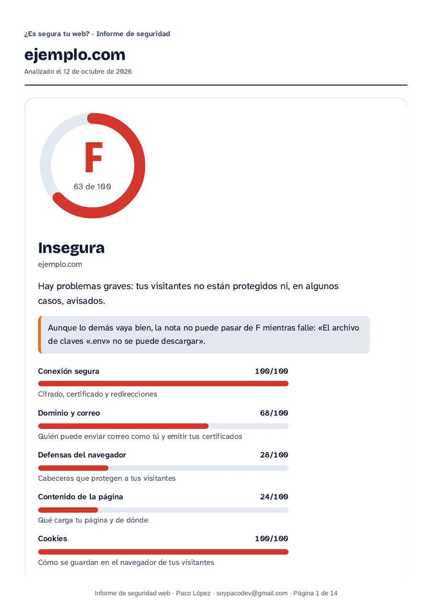

<p align="center">
  
</p>

<h1 align="center">¿Es segura tu web?</h1>

<p align="center">
  <strong>Revisión gratuita de seguridad para webs de pequeños negocios:</strong><br>
  pegas la dirección y recibes una nota de la A+ a la F, qué falla, por qué importa y cómo se arregla.
</p>

<p align="center">
  <a href="https://github.com/soypacodev/es-segura-tu-web/actions/workflows/ci.yml"></a>
  <a href="LICENSE"></a>
  
  
  
  
</p>

<p align="center">
  <a href="https://es-segura-tu-web.vercel.app"><strong>Revisar una web</strong></a> ·
  <a href="#qué-comprueba">Qué comprueba</a> ·
  <a href="#seguridad">Seguridad</a> ·
  <a href="#ejecutarlo-en-local">Ejecutarlo en local</a> ·
  <a href="docs/CRITERIOS.md">Criterios</a> ·
  <a href="docs/ARQUITECTURA.md">Arquitectura</a> ·
  <a href="#in-english">English</a>
</p>

<p align="center">
  
</p>

> **Análisis pasivo.** Equivale a visitar la página con un navegador: una o dos peticiones normales y la consulta de los registros públicos del dominio. No ataca, no prueba contraseñas y no guarda nada de la web. Solo si la persona marca que es responsable de la web (o tiene permiso) se comprueba además una lista fija de 17 archivos que no deberían estar a la vista, sin guardar ni mostrar nunca su contenido.

---

## Qué incluye

- **Nota de la A+ a la F** con un veredicto en lenguaje llano y una nota por categoría. Algunos fallos graves ponen techo a la nota, y el informe dice cuál.
- **«Empieza por esto»**: las tres mejoras que más suben la nota, con cuántos puntos da cada una.
- **Simulador**: marca «Lo arreglaría» en cualquier punto y la nota se recalcula al momento.
- **Cada punto explicado**: qué significa, cómo se arregla y, cuando se puede, el código o la configuración exacta para copiar.
- **Informe en PDF**: vista A4 sin interfaz, con todo desplegado y el pie del autor.
- **Enlace para compartir**: guarda el informe 30 días y da una dirección con su propia vista previa para WhatsApp, LinkedIn o Slack.

<p align="center">
  
</p>

<p align="center">
  
  &nbsp;&nbsp;
  
</p>

## Qué comprueba

Ocho categorías, más una opcional. Cada comprobación tiene su peso:

| Categoría | Qué mira |
| --- | --- |
| Conexión segura | HTTPS disponible y obligatorio, certificado (validez y caducidad), versión de TLS, HSTS, subdominios y precarga |
| Dominio y correo | SPF, DMARC y CAA del dominio |
| Defensas del navegador | CSP, protección contra clickjacking, `nosniff`, `Referrer-Policy`, `Permissions-Policy` |
| Contenido de la página | Contenido mixto, formularios que envían sin cifrar, integridad (SRI) y número de servidores ajenos |
| Cookies | `Secure`, `HttpOnly`, `SameSite` |
| Privacidad y RGPD | Rastreadores de terceros, aviso de cookies, política de privacidad, aviso legal y tipografías externas |
| Tecnologías expuestas | Versiones que cuenta el servidor, gestor de contenidos, PHP y librerías de JavaScript sin soporte o con fallos conocidos |
| Rendimiento y buenas prácticas | Compresión, caché, peso del HTML, redirecciones, codificación, adaptación a móvil, idioma y título |
| Archivos expuestos *(opcional)* | `.env`, `.git`, copias de seguridad, `phpinfo`, páginas de estado del servidor y `.DS_Store` |

Los pesos, los techos y el porqué de cada decisión están en [docs/CRITERIOS.md](docs/CRITERIOS.md).

## Cómo está hecho

- **Next.js 16** (App Router), **React 19**, **TypeScript** estricto y **Zod** para validar toda entrada.
- **El motor son funciones puras**: reciben una «captura» de la web y devuelven hallazgos (un identificador y unos datos). Los textos viven aparte, en `src/lib/textos`, así que el motor se prueba sin red y se puede traducir sin tocarlo.
- **Respuesta en streaming (NDJSON)**: la interfaz enseña el progreso mientras se analiza.
- **Sin dependencias para lo delicado**: lector HTML propio con presupuesto de trabajo, DNS por c-ares y Supabase por su API REST con `fetch`.
- **Imágenes de vista previa** generadas en el servidor con las mismas fuentes de la web.

Más detalle en [docs/ARQUITECTURA.md](docs/ARQUITECTURA.md).

## Seguridad

Una herramienta que descarga direcciones elegidas por desconocidos es un objetivo en sí misma:

- **A prueba de SSRF**: solo puertos 80 y 443, todas las IP resueltas deben ser públicas, conexión a la IP ya validada y nueva validación en cada redirección.
- **Límites** de tiempo y tamaño (también tras descomprimir), y de uso por visitante (las IPv6 se agrupan por /64).
- **La propia web**: CSP con nonce por petición, HSTS con precarga, `X-Frame-Options`, `Permissions-Policy` y comprobación de `Origin`.
- **Enlaces compartidos**: solo se guarda un informe firmado por el servidor (HMAC), nunca uno con archivos expuestos; identificadores de 128 bits, `noindex` y caducidad. La tabla tiene RLS sin políticas: solo el servidor la toca.

Todo, con lo que se acepta y por qué, en [docs/SEGURIDAD.md](docs/SEGURIDAD.md).

## Calidad

- Más de 1.000 pruebas con Vitest: cada comprobación, la puntuación, el descargador contra servidores locales, la API y la firma de informes.
- Integración continua en cada push: ESLint, TypeScript, pruebas y compilación.
- Revisado a 320, 390, 768, 1280 y 1920 px, en claro y en oscuro, con teclado y con axe.

## Ejecutarlo en local

Requiere Node 22.18 o superior.

```bash
git clone https://github.com/soypacodev/es-segura-tu-web.git && cd es-segura-tu-web
npm install
npm run dev          # http://localhost:3000
```

También desde la terminal, sin interfaz:

```bash
npm run analizar -- ejemplo.com
npm run analizar -- ejemplo.com --json
```

| Comando | Qué hace |
| --- | --- |
| `npm run dev` | Servidor de desarrollo |
| `npm run build` / `npm start` | Compilación y servidor de producción |
| `npm run lint` | ESLint |
| `npm run typecheck` | TypeScript sin emitir |
| `npm test` | Pruebas (Vitest) |
| `npm run verificar` | Todo lo anterior, en orden |

## Enlaces para compartir (opcional)

Sin estas variables la web funciona igual y el botón no aparece. En desarrollo, sin Supabase, los informes se guardan en memoria para poder probarlo.

| Variable | Para qué |
| --- | --- |
| `SUPABASE_URL` | Dirección del proyecto (`https://….supabase.co`) |
| `SUPABASE_SERVICE_ROLE_KEY` | Clave de servicio: solo en el servidor, nunca en el navegador |
| `INFORME_SECRETO` | Cadena aleatoria de 32 caracteres o más con la que el servidor firma los informes |
| `INFORME_DIAS` | Días que se conserva un informe compartido (1–365; por defecto 30) |
| `CRON_SECRET` | Cadena aleatoria (16 caracteres o más) para el cron diario de `vercel.json` |

La tabla se crea con [`supabase/informes.sql`](supabase/informes.sql). Un cron diario de Vercel (`/api/mantener-activo`) hace una consulta mínima para que Supabase gratuito no pause el proyecto por inactividad.

## Límites conocidos

- No ejecuta JavaScript: analiza el HTML y las cabeceras que recibe, no lo que la página dibuja después en el navegador.
- Si no puede leer la página entera (tamaño o tiempo), el informe lo dice y no saca conclusiones de lo que «falta».
- Una nota alta no garantiza que una web sea segura: mide buenas prácticas visibles desde fuera, no es una auditoría.

## In English

**¿Es segura tu web?** ("Is your website secure?") is a free website security checker for small businesses. Paste an address and get an **A+ to F grade** with a plain-language report: what is wrong, why it matters and how to fix it, with copy-paste configuration where possible. Reports can be printed to PDF or shared through a link that expires after 30 days.

**[Try it](https://es-segura-tu-web.vercel.app)** · the interface and the code comments are in Spanish.

- **Passive by design**: one or two normal requests plus public DNS records. An optional, permission-based check looks for 17 well-known exposed files (`.env`, `.git`, backups…) without ever storing or showing their contents.
- **Checks**: HTTPS and certificates, HSTS, SPF/DMARC/CAA, security headers, mixed content, SRI, cookies, third-party trackers and GDPR basics, exposed versions and outdated JavaScript libraries, and performance basics.
- **Built with** Next.js 16, React 19 and strict TypeScript. The engine is a set of pure functions with more than 1,000 tests; the app itself has an SSRF-safe downloader, a nonce-based CSP, rate limiting and HMAC-signed shared reports stored in Supabase behind row-level security.

## Licencia

[MIT](LICENSE).

## ¿Quieres que revise tu web?

Lo hice yo, **Paco López**, desarrollador full-stack: webs y apps seguras para pequeños negocios. Si el informe te ha sacado cosas que no sabes arreglar, o quieres una web hecha así desde el principio, escríbeme a **soypacodev@gmail.com**.

Otros proyectos:

- [**Portfolio**](https://soypacodev.vercel.app): mis trabajos, servicios y cómo contactar conmigo.
- [**Ovillo & Co.**](https://github.com/soypacodev/ovillo-co) · [demo](https://ovillo-co.vercel.app): tienda online de demostración con catálogo, pago con Stripe, cuentas y panel del dueño.
- [**Cachivache**](https://github.com/soypacodev/cachivache): limpiador de disco para Windows que explica qué va a borrar y por qué.
